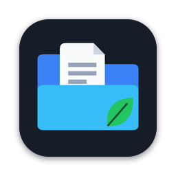

<p align="center">
  
</p>

<h1 align="center">MoneyPaperSync</h1>

<p align="center">
  Kontoauszüge aus <b>MoneyMoney</b> automatisch in <b>Paperless-ngx</b> archivieren.<br>
  Native macOS-App (SwiftUI, macOS 14+) im Dark-Glass-Design.
</p>

---

## Wofür ist die App?

MoneyMoney legt Kontoauszüge als PDF in einem Ordner ab. MoneyPaperSync überwacht diesen Ordner, erkennt zu jedem PDF **Bank, Konto und Zeitraum** direkt auf deinem Mac und lädt es mit passendem Titel, Korrespondent und Tags in dein Paperless-ngx hoch. Du musst nichts mehr von Hand sortieren oder hochladen.

## Was du damit machen kannst

- **Automatisch archivieren:** Neue PDFs im MoneyMoney-Statements-Ordner werden erkannt, geprüft und nach Paperless-ngx hochgeladen. Ein Dashboard zeigt, ob alles läuft.
- **Bank, Konto und Zeitraum erkennen:** Die Erkennung liest den Text im PDF (nicht nur den Dateinamen). Konten werden über IBAN, **Kreditkartennummer** (z. B. AMEX) oder **Sparbuchnummer** zugeordnet.
- **Konten und Banken verwalten:** Eigene Erkennungsmerkmale pro Bank, Konten mit Kontoart (Girokonto, Kreditkarte, Sparbuch, Tagesgeld, …), Paperless-Korrespondent, Tags und Titelvorlage pro Konto. Gängige Banken lassen sich mit einem Klick hinzufügen.
- **Bereits vorhandene PDFs neu zuordnen:** „Banken zuordnen“ im Dokumente-Tab liest alle PDFs erneut und weist die passende Bank zu, für alle Banken oder nur für eine gewählte. Es wird nichts erneut hochgeladen.
- **Dokumente prüfen und steuern:** Dokumentenliste mit Suche und Filtern, PDF-Vorschau, Warteschlange mit Fortschritt, erneutes Versuchen, manuelle Zuordnung, Dubletten- und Fehlerbehandlung.
- **Erstimport festlegen:** Alle vorhandenen PDFs, PDFs ab einem Datum oder nur neue.
- **Im Hintergrund laufen:** Optionales Menüleisten-Symbol mit Status und Schnellaktionen, Benachrichtigungen bei Importen, Fehlern und Verbindungsverlust.
- **Sich selbst aktualisieren:** Die App sucht regelmäßig nach neuen Releases, lädt sie und ersetzt sich selbst.
- **Nachvollziehen:** Protokoll aller Schritte (PDF erkannt, Hash berechnet, Upload, Ergebnis), ohne vollständige IBANs oder Tokens.

## Datenschutz und Sicherheit

- Die Analyse läuft **lokal**. Nur das PDF selbst geht an deinen eigenen Paperless-ngx-Server.
- Der MoneyMoney-Ordner wird **nur gelesen**, Original-PDFs werden nie verändert (Sandbox, Security-Scoped Bookmark).
- Der API-Token liegt ausschließlich im **macOS-Schlüsselbund**.
- IBANs, Karten- und Sparbuchnummern werden nur **maskiert** gespeichert (letzte vier Stellen).
- Updates sind mit einem Schlüssel signiert, fremde Updates nimmt die App nicht an.

## Installation

1. Lade die neueste `MoneyPaperSync.dmg` von der [Release-Seite](https://github.com/alexanderschubert/moneypapersync/releases/latest).
2. DMG öffnen und die App nach **Programme** ziehen.
3. Beim ersten Start auf einem fremden Mac: Rechtsklick → **Öffnen**, denn die App ist nur ad-hoc signiert (kein Entwickler-Zertifikat).
4. Der Einrichtungsassistent führt durch MoneyMoney-Ordner, Paperless-Zugang, Zuordnung und Erstimport.

Updates kommen danach von selbst (Einstellungen → Allgemein → Updates).

### Einrichtung in Kürze

- **MoneyMoney-Ordner:** „MoneyMoney-Ordner suchen …“ erkennt die installierte MoneyMoney-App und öffnet deren Datenordner. Du bestätigst ihn einmal, die App sucht darin nach Ordnern mit PDFs.
- **Paperless-ngx:** Server-URL und API-Token eintragen (Token unter „Mein Profil“ in Paperless) und die Verbindung testen.

## Selbst bauen

Voraussetzungen: Xcode (Swift, macOS 14 SDK) und [xcodegen](https://github.com/yonaskolb/XcodeGen).

```bash
brew install xcodegen
xcodegen generate
xcodebuild -scheme MoneyPaperSync -destination 'platform=macOS' build
```

Danach `MoneyPaperSync.xcodeproj` öffnen und mit ⌘R starten. UI-Tests (`test` statt `build`) brauchen die Freigabe für Bedienungshilfen. Branches und Releases sind in [docs/ENTWICKLUNG.md](docs/ENTWICKLUNG.md) beschrieben. Ein Release baut `scripts/release.sh <Version> <Build> --publish`.

Icons neu erzeugen: `python3 scripts/make_icons.py` (Pillow).

## Projektstruktur

```
MoneyPaperSync/
  App/        App-Einstieg, Umgebung, Hauptfenster, Menüleiste
  Design/     Designsystem (Farben, Abstände, Typografie, Glass) und Komponenten
  Models/     SwiftData-Modelle: Bank, Konto, Dokument, Protokoll
  Services/   Einstellungen, Schlüsselbund, Paperless-Client, PDF-Analyse, Ordnerüberwachung,
              Synchronisation, MoneyMoney-Suche, Updater
  Views/      Dashboard, Dokumente, Warteschlange, Konten, Banken, Protokoll, Einstellungen, Onboarding
MoneyPaperSyncUITests/   UI-Rauchtests
```

## Bekannte Grenzen

- Die Erkennung von Datum und Zeitraum ist heuristisch. Bei Fehlern hilft „Erkennung bearbeiten“.
- Kartennummern werden nur gefunden, wenn sie im PDF-Text stehen (voll oder teilweise verdeckt).
- Die Antworten von Paperless-ngx unterscheiden sich leicht je nach Version; die App liest sie tolerant.
- „Beim Anmelden starten“ braucht eine echte Signatur und funktioniert mit dem ad-hoc-signierten Build voraussichtlich nicht.
